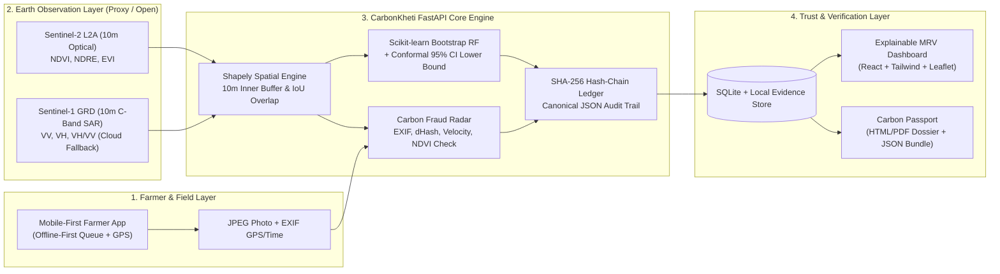

# CarbonKheti PS-13 — System Architecture

**Team DoSA | INNOVASIA 2K26**

## 1. Architectural Overview

CarbonKheti separates **geospatial & ML computation**, **cryptographic auditability**, and **farmer/auditor interfaces** into a modular two-tier architecture designed to keep automated MRV costs toward a target of **≤ ₹100/hectare/year** (project target excluding third-party VVB/registry fees).

## 2. Key Design Trade-Offs ("We Chose X Over Y Because Z")

| Decision | Chosen Approach | Rejected Alternative | Rationale |
| :--- | :--- | :--- | :--- |
| **Issuance Metric** | **95% CI Lower Bound** | Point / Mean Estimate | Structurally prevents over-crediting and turns uncertainty (clouds, small plot size) into an accuracy incentive. |
| **Monsoon Resilience** | **Sentinel-1 C-Band SAR Fallback + CI Inflation** | Dropping cloudy months or interpolating blindly | Indian Kharif monsoon blocks optical imagery for months; SAR penetrates cloud while wider intervals honestly reflect SAR saturation. |
| **Smallholder Edge Bias** | **10m Inner Negative Buffer (`buffer(-10)`)** | Raw polygon pixel averaging | Smallholder plots (0.25–1 ha) suffer severe border pixel mixing; inner buffering isolates pure canopy pixels. |
| **Tamper Evidence** | **SHA-256 Hash Chain + External Head Anchor** | Full on-chain blockchain/tokens | Achieves cryptographic tamper-evidence with zero gas fees, matching the ≤₹100/ha/yr cost target. |
| **Photo Deduplication** | **SHA-256 + 64-bit Perceptual dHash** | SHA-256 alone | Catching re-compressed, resized, or WhatsApp-forwarded duplicate photos requires perceptual similarity, not just byte equality. |
| **Carbon Scope (Phase 1)** | **AGB (Satellite) + BGB (IPCC R=0.24)** | Claiming Soil Organic Carbon (SOC) from NDVI | NDVI tracks vegetation canopy, not soil carbon; SOC, dead wood, and litter are conservatively excluded in Phase 1. |

